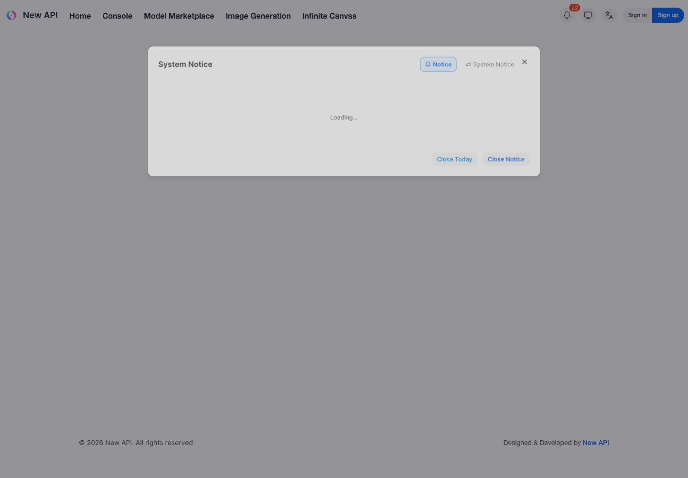
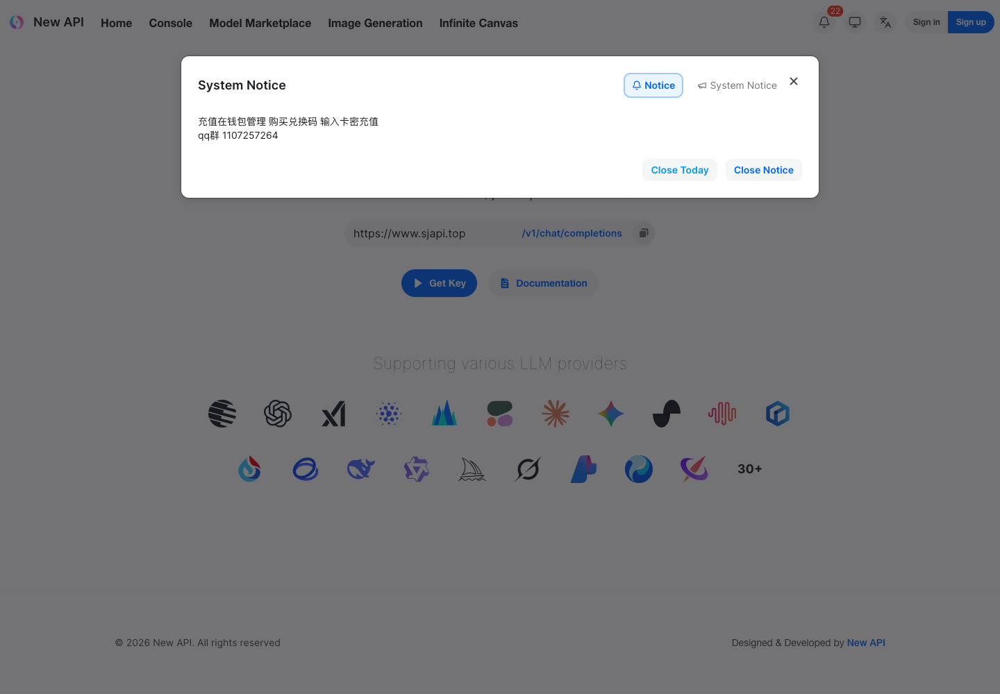
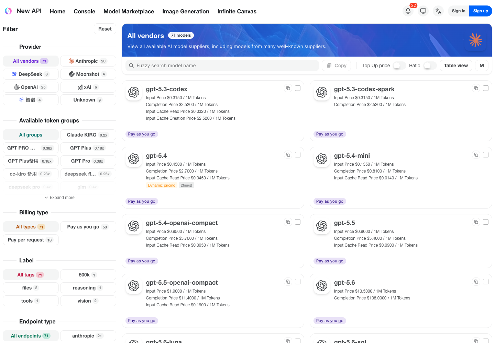

# SJ API：Codex / GPT 按量价公开，适合小额验证的模型网关（2026）

**选择结论：**SJ API 适合想按公开的每百万 token 价格试用 Codex、GPT 与图片模型，并且愿意自己核对 Model ID、缓存计费和动态分组的开发者。首选从 `gpt-5.4-mini` 或 `gpt-5.3-codex` 开始，用一笔小额余额验证代码任务；不要直接用高价 `gpt-5.6` 跑长上下文。

[通过本站入口开始 SJ API 小额测试](https://www.sjapi.top/register?aff=IVpL)

## 为什么值得看

SJ 的公开模型广场直接展示输入、输出、缓存读取与缓存创建价格，并区分 token 计费和按请求计费。对于 Codex 用户，价格页同时列出 `gpt-5.3-codex`、`gpt-5.4-mini`、`gpt-5.4` 等多个梯度，方便从低成本模型开始，而不是把所有任务都交给最贵的一档。

它使用 New API 网关界面，首页提供控制台、模型广场、图片生成与无限画布入口。公开价格页当前列出 71 个模型，文本、编程和图片请求可以在一个余额体系里管理。

## 适合谁 / 不适合谁

**适合：**

- Codex 或 OpenAI 兼容工具用户，希望按量计费；
- 想明确看到输入、输出和缓存价格的人；
- 需要文本与图片模型放在同一个网关的小型项目；
- 会先做预算上限和失败重试控制的开发者。

## 公开价格：从低成本档开始

以下为 2026-11-10 公开模型广场的美元计价，单位为每 1M tokens；缓存创建只在页面列出时展示。

| 模型 | 输入 | 输出 | 缓存读取 | 缓存创建 | 推荐场景 |
|---|---:|---:|---:|---:|---|
| `gpt-5.4-mini` | $0.135 | $0.810 | $0.014 | — | 接入验证、短脚本、简单修复 |
| `gpt-5.3-codex` | $0.315 | $2.520 | $0.032 | $2.520 | Codex 代码任务 |
| `gpt-5.4` | $0.450 | $2.700 | $0.045 | 动态分组 | 日常编码与复杂任务 |
| `gpt-5.6-luna` | $0.180 | $1.080 | $0.018 | $0.225 | 低价长任务候选 |
| `gpt-5.6-sol` | $0.900 | $5.400 | $0.090 | $1.125 | 更高预算编码任务 |
| `gpt-6-sol` | $0.360 | $1.800 | $0.036 | 动态分组 | 新模型试跑 |
| `gpt-image-2` | $0.050 / 请求 | — | — | — | 图片生成 |

`gpt-5.6` 的公开价为输入 $13.50、输出 $108 / 1M tokens，和 `gpt-5.6-luna`、`sol` 不是同一个成本档。自动化脚本必须按完整 Model ID 固定模型，避免误选高价条目。

[查看 SJ API 并先测试 mini / codex 档](https://www.sjapi.top/register?aff=IVpL)

## Codex 与 OpenAI 兼容工具怎么接

SJ 使用通用模型网关。接入时在控制台创建 API Key，再从模型广场完整复制 Model ID。Codex、Cline、Cherry Studio 或 OpenAI SDK 都需要明确配置 SJ 提供的 Base URL、Key 和模型名。

首轮测试建议固定三个任务：

1. 读取一个小仓库并总结结构；
2. 修改一处可由测试覆盖的代码；
3. 执行测试并输出 diff。

在控制台核对这三次请求的输入、输出、缓存和重试。若客户端自动追加模型后缀、映射别名或连续重试，先关闭自动路由，再做成本判断。

## 为什么从 `gpt-5.4-mini` 或 `gpt-5.3-codex` 开始

`gpt-5.4-mini` 的输入 / 输出价最低，适合确认 Key、Base URL、工具调用和扣费链路。需要更完整的编码行为时，再切到 `gpt-5.3-codex`。只有当真实任务表现证明值得，才升级 `gpt-5.4`、`sol` 或更高档模型。

这种买法能防止两个常见浪费：一是配置错误导致大量失败重试；二是把短任务送给高价模型。模型广场中的动态分组也意味着同名模型可能有不同线路与价格，最终应以 Key 所属分组的结算记录为准。

## Key与预算怎么管理

SJ 的公开页能核到模型与价格，但公开企业采购、退款流程、余额有效期、请求内容保存方式、日志保留期限和删除机制没有形成完整对外说明。个人小额试用可以先验证；企业、客户数据或大额充值应在这些字段补齐后再决定。

不同项目使用独立Key，并设置额度、允许模型和最大重试次数。给每个项目单独 Key、设置额度、限制可用模型，并在任务端限制最大重试次数与并发。

## 购买前检查清单

1. 从价格页复制完整 Model ID，不使用模糊别名；
2. 用 `gpt-5.4-mini` 或 `gpt-5.3-codex` 完成首轮测试；
3. 检查输入、输出、缓存创建和缓存读取分别如何扣费；
4. 检查 Key 所属分组是否包含目标模型；
5. 设置单 Key 额度和客户端最大重试；
6. 大额充值前取得退款、余额有效期、日志保留和企业主体信息；
7. 只传可进入第三方模型链路的数据。

## FAQ

### SJ 是订阅还是按量？
公开模型广场展示 Pay as you go，文本模型主要按每 1M tokens 计费，图片模型可按请求计费。

### Codex 从哪个模型开始？
先用 `gpt-5.3-codex`；若只做连接和简单修复，可先用 `gpt-5.4-mini`。

### 为什么同一系列价格差很多？
完整 Model ID 对应不同模型或路由档。`gpt-5.6`、`gpt-5.6-luna` 与 `gpt-5.6-sol` 必须分开看。

### 能否用于无人值守 Agent？
可以先在低额度 Key 上验证，但必须限制并发、重试、最大上下文和允许模型，避免循环消耗余额。

### 退款和隐私如何判断？
公开页还不足以承担大额采购判断；在补齐条款前，把 SJ 定位为小额、可停止的技术验证入口。

## 最终建议

SJ 的优势是 Codex / GPT 模型价格公开、梯度清楚。对开发者最合理的买法，是低成本模型跑通真实代码任务，再用日志决定是否升级，而不是先充值再猜模型。

[通过本站入口开始 SJ API](https://www.sjapi.top/register?aff=IVpL)

## sj替代方案与相关搜索

可对比的方向包括官方API、单一Coding专线和多模型中转；选择时结合价格、充值、接入与自己的常用客户端。

相关搜索：sj价格、sj充值、sj Claude Code、sj Codex。
